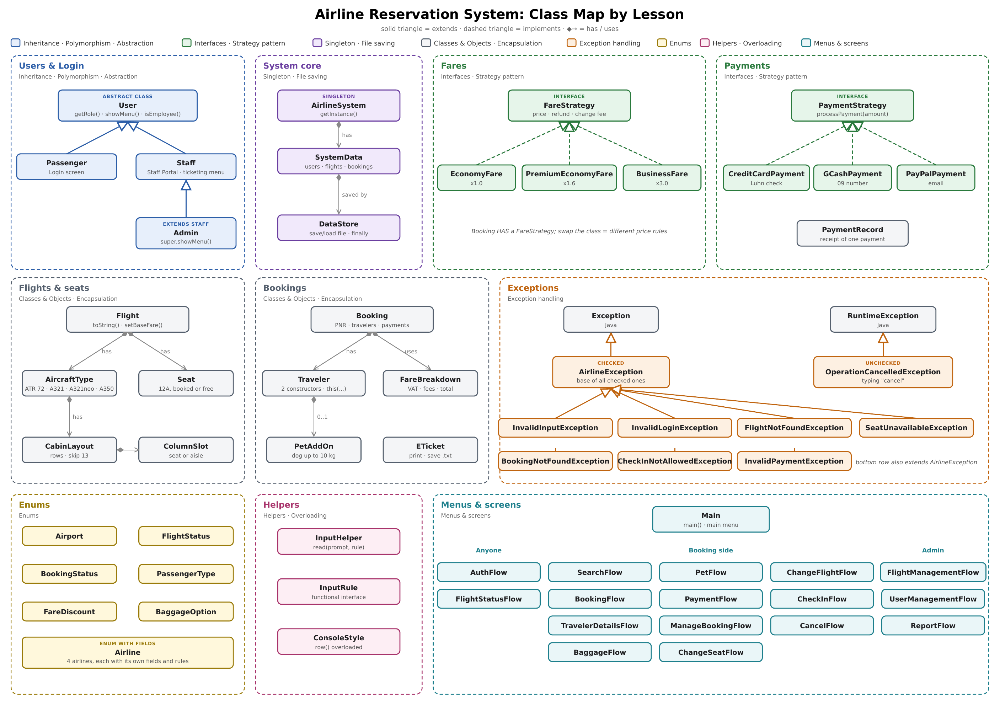
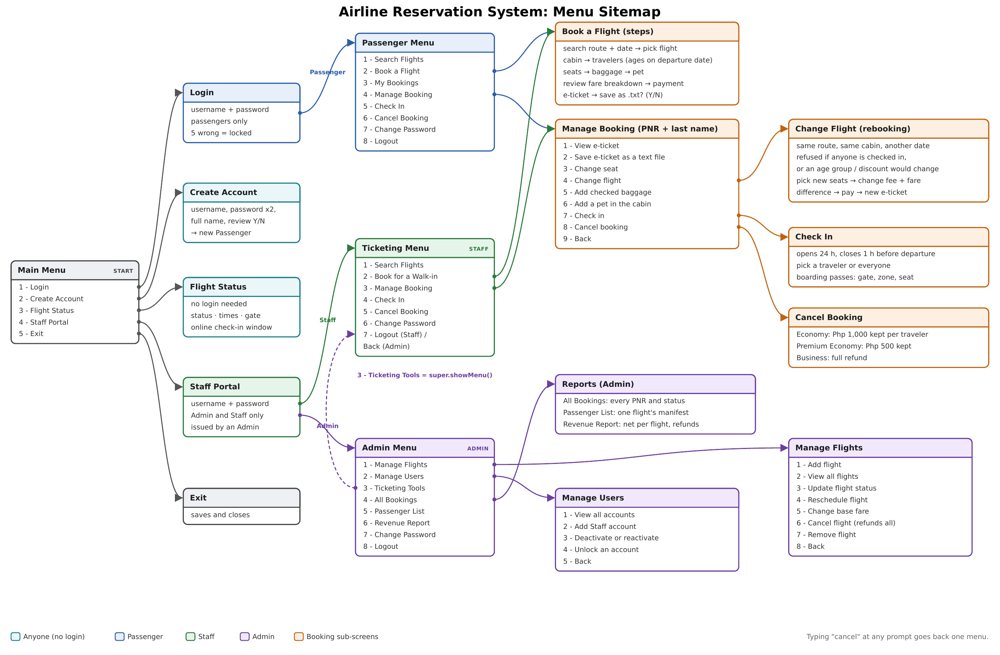
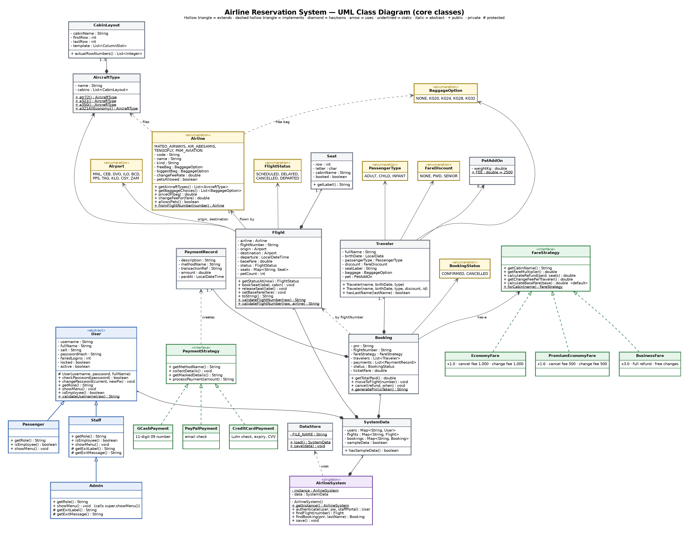

# Airline Reservation System

A console airline reservation system in Java that sells flights from four airlines on domestic Philippine routes. Passengers search, compare, book, and manage flights. Staff book for walk-in customers at the counter. Admins run the flights, accounts, and reports.

OOPROG Final Project · Group 1, Section C2B

## What's in this repo

| Folder | What's inside |
| --- | --- |
| [`Macaraig/`](Macaraig) | Paolo's part: system core, accounts and login, saving, input, baggage |
| [`Abesamis/`](Abesamis) | Art's part: airlines, flights, search, flight management, reports, pets, exceptions |
| [`Tengonciang/`](Tengonciang) | Kurt's part: seat maps, fares, bookings, change seat, change flight, e-tickets |
| [`Mateo/`](Mateo) | Mateo's part: payments, passenger types and discounts, manage booking, check-in, cancellation |
| [`documentation/`](documentation) | Project documentation, a full sample run, and the diagrams |
| [`TEST-ACCOUNTS.txt`](TEST-ACCOUNTS.txt) | Sample logins, bookings, and test payment details |

Each member committed their own files to their own folder. The four folders together are the whole program: compile them in one command (below).

## Documentation

- [Project Documentation (PDF)](documentation/Project_Documentation.pdf): design, task division, input rules, design rationale, diagrams, and our test guide
- [Sample Run (PDF)](documentation/Airline_Sample_Run.pdf): one full session of the program, every screen and error message
- Google Docs version: (https://docs.google.com/document/d/1fJWcjYEtMYQCCSK5_JeBxx0kvA6RGNDKWx_iYNuTqY0/edit?usp=sharing)

## How to run

Java 11 or newer.

```
javac -d out Macaraig/*.java Abesamis/*.java Tengonciang/*.java Mateo/*.java
java -cp out Main
```

Run both lines from the repo's main folder (the one with this README).

Or open the repo's main folder in VS Code, open `Macaraig/Main.java`, and click **Run**. The included `.vscode/settings.json` tells VS Code that the four folders are one program.

The program saves everything to `airline-data.ser`. To start over with fresh sample data, close the program and delete that file.

## Test accounts

Sample accounts, bookings, and payment details are in [TEST-ACCOUNTS.txt](TEST-ACCOUNTS.txt).

| Role | Log in through | Username | Password |
| --- | --- | --- | --- |
| Admin | 4 - Staff Portal | `admin` | `admin123` |
| Staff | 4 - Staff Portal | `staff01` | `staff123` |
| Passenger | 1 - Login | `passenger01` | `passenger123` |

## Features

| Who | What they can do |
| --- | --- |
| Anyone | Create an account, check a flight's status |
| Passenger | Search flights, book 1 to 4 travelers plus infants, pick seats, add baggage and a pet, pay by card, GCash, or PayPal, view and save the e-ticket, change seat, change flight, check in, cancel, change password |
| Staff | Everything a passenger can do with a booking, for walk-in customers |
| Admin | Add, reschedule, re-price, cancel, and remove flights; manage accounts; all bookings, passenger lists, and revenue reports; plus every Staff tool |

## The four airlines

| Airline | Code | Kind | Plane | Free checked bag | Change fee | Pets |
| --- | --- | --- | --- | --- | --- | --- |
| Mateo Airways | MW | Premium full-service | Airbus A350 (Business, Premium Economy, Economy) | 20 kg | Half the cabin's fee | Yes |
| Air Abesamis | AB | Full-service | Airbus A321 (Business, Economy) | 20 kg | The cabin's fee | Yes |
| TengoFly | TF | Low-cost | Airbus A321neo (Economy only) | None | 1.5x the cabin's fee | Yes |
| PAM Aviation | PM | Regional island-hopper | ATR 72 (Economy only) | None, bags up to 20 kg | The cabin's fee | No |

A booking can only be changed to another flight of the same airline.

Real airline rules: no row 13 and no seat letter I, ages counted on the departure date, Senior and PWD 20% discount with VAT exemption, a 24-hour to 1-hour check-in window, and refunds and change fees that depend on the cabin.

## OOP concepts used

| Concept | Where |
| --- | --- |
| Enum with fields | `Airline`: each airline is one object with its own code, plane, baggage, change fee, and pet rule |
| Encapsulation | Private fields with validating methods, e.g. `User.changePassword()`, `Flight.setBaseFare()` |
| Inheritance | `Passenger` and `Staff` extend `User`; `Admin` extends `Staff` |
| Abstraction | Abstract `User`; interfaces `FareStrategy` and `PaymentStrategy` |
| Polymorphism | `user.showMenu()` runs each role's own menu; overloaded `ConsoleStyle.row()` and `Flight.validateFlightNumber()` |
| Singleton | `AirlineSystem.getInstance()` |
| Strategy | `FareStrategy` (Economy, Premium Economy, Business) and `PaymentStrategy` (Card, GCash, PayPal) |
| Exception handling | Custom checked exceptions under `AirlineException`; `OperationCancelledException` for "cancel"; try-with-resources and `finally` when saving |

## Diagrams







## Team

| Member | Folder | Part of the system |
| --- | --- | --- |
| Paolo Adrian Macaraig (leader) | [`Macaraig/`](Macaraig) | System core, accounts and login, menus, saving to file, input handling, checked baggage |
| Artvincent Abesamis | [`Abesamis/`](Abesamis) | Airlines, flights, search, flight status, flight management, reports, pets, exceptions |
| Kurt Tengonciang | [`Tengonciang/`](Tengonciang) | Seat maps, fares, bookings, booking flow, change seat, change flight, e-tickets |
| Eam Jae Mateo | [`Mateo/`](Mateo) | Payments, passenger types and discounts, manage booking, check-in, cancellation |
